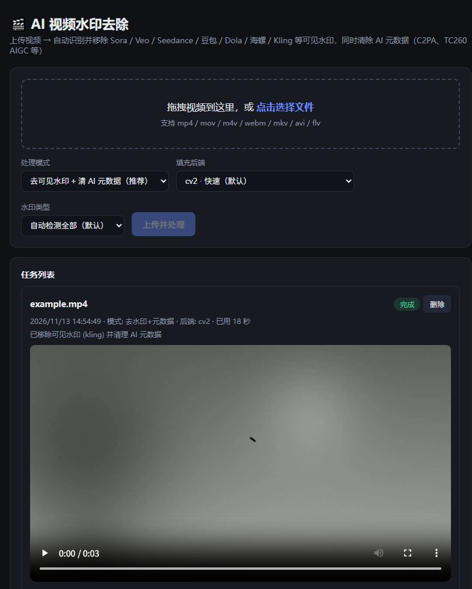

# zc-qushuiying · AI 视频水印去除（中文部署版）

基于开源项目 [wiltodelta/remove-ai-watermarks](https://github.com/wiltodelta/remove-ai-watermarks) 的开箱即用部署方案，新增了一个中文 WebUI：浏览器上传视频 → 自动去除可见 AI 水印并清除 AI 元数据 → 网页内预览、下载。局域网内任何设备都能访问。



## 功能

- 拖拽 / 点击上传视频，支持 mp4 / mov / m4v / webm / mkv / avi / flv
- **自动识别来源**：检测到即梦 / Dreamina 导出时，自动切换到区域擦除 + MI-GAN
- **区域擦除模式**：处理上游未注册的可见水印（即梦左上「AI生成」药丸 + **四角轮换的 logo/@昵称，自动定位**）
- 自动检测并移除已注册的可见 AI 水印：Sora 2、Veo、Seedance、豆包、Dola、海螺 AI、Kling AI、Vidu 等
- 清除 AI 元数据：C2PA、EXIF/XMP 生成参数、中国 TC260 `AIGC` 标签等（不重编码视频流）
- 填充后端可选：cv2（快速、纯本地）/ MI-GAN / LaMa（质量更好，首次使用联网下载模型）
- 任务列表实时显示进度与日志；完成后页面内直接预览（支持拖动进度条）并一键下载
- 可选：自动剪掉视频最后 5 秒（流复制截断，不重编码，几乎瞬时完成；视频过短时自动跳过）
- 单任务串行队列；上传与输出文件保留 24 小时后自动清理，也可手动删除
- 全程 CPU 运行，无需 GPU、无需系统 ffmpeg（依赖自带便携版 ffmpeg）

## 快速开始

### 一键部署（Windows）

```powershell
git clone https://github.com/<你的账号>/zc-qushuiying.git
cd zc-qushuiying
powershell -ExecutionPolicy Bypass -File deploy.ps1
```

`deploy.ps1` 会自动完成：克隆上游仓库 → 把 `webui/` 装进去 → `uv sync` 安装依赖（含便携 ffmpeg）→ 放行防火墙端口 → 打印访问地址。

### 启动

```bat
start.bat
```

- 本机访问：http://127.0.0.1:8000/
- 局域网访问：http://<本机IP>:8000/（启动时控制台会打印实际 IP；防火墙规则名 `Remove AI Watermarks WebUI`）

### 手动部署

```powershell
git clone --depth 1 https://github.com/wiltodelta/remove-ai-watermarks
Copy-Item -Recurse -Force zc-qushuiying\webui remove-ai-watermarks\webui
cd remove-ai-watermarks
uv sync --frozen --extra video --extra migan
cd webui
..\.venv\Scripts\python.exe app.py
```

> 需要已安装 [uv](https://docs.astral.sh/uv/)（`pip install uv` 或官方安装脚本）。国内网络克隆/下载失败时，可在 clone 地址前加镜像前缀，例如 `https://ghfast.top/https://github.com/...`。

## 为什么需要区域擦除模式

上游的视频可见水印检测表只注册了 8 个厂商：`sora / veo / seedance / doubao / dola / hailuo / vidu / kling`。**即梦（Jimeng / Dreamina）不在其中**，这是上游的主动决定而非疏漏——`docs/module-internals.md` 记录该水印被 PARKED：

> 即梦 CN 水印在视频上模板匹配分不开正负样本（1/5 正样本 vs 2/25 负样本），左上「AI生成」药丸的误报模式是静态纹理角，时间递归仲裁器无法拦截。

所以对即梦视频跑 `video all` 会得到「未检测到可见水印」，直接输出直通版本——三个填充后端都没有机会工作。

`webui/erase_engine.py` **不修改上游注册表**，而是复用上游同一条逐帧填充与原子编码管线（同样的 cv2 / MI-GAN / LaMa 后端、色彩档案、VFR 时间戳、HDR 拒绝、音频流复制、元数据剥离），接受手动或预设区域直接擦除。即梦预设区域按 1280x720 实测标定，并按帧尺寸等比缩放。

### 后端性能与效果（1280x720，1280 视频实测）

| 后端 | 速度（CPU） | 速度（V100 GPU） | 边界干净度 |
| --- | --- | --- | --- |
| cv2 | ~0.04 秒/帧 | 不走 GPU | 简单背景可用；复杂纹理区会有涂抹拉丝 |
| MI-GAN | ~1.1 秒/帧 | **~0.04 秒/帧** | 干净，即梦 logo 区域无痕（推荐） |
| LaMa | ~10.8 秒/帧 | **~0.12 秒/帧** | 最佳 |

> 多区域会合并为**一次**前向计算（两个区域从 2.18s/帧降到 1.09s/帧）。

### 国内网络：HuggingFace 镜像

MI-GAN / LaMa 模型从 HuggingFace 下载，国内直连会超时。WebUI 启动时自动设置：

```
HF_ENDPOINT=https://hf-mirror.com
```

也可用系统环境变量永久生效。

### GPU 加速（可选，自动回退）

MI-GAN / LaMa 推理支持 NVIDIA GPU 加速，**默认优先 CUDA，任何环节失败都自动回退 CPU**，不会让任务失败。

| 情况 | 行为 |
| --- | --- |
| GPU 可用、显存充足 | 使用 `CUDAExecutionProvider` |
| 未安装 GPU 版 onnxruntime | 静默使用 CPU |
| 驱动 / CUDA / cuDNN 缺失 | 静默使用 CPU |
| 显存不足（< 1 GB 空闲） | 静默使用 CPU |
| 推理中途 GPU 报错 | 禁用 CUDA 后整段用 CPU 重跑一次 |
| 想强制 CPU | 设置环境变量 `WEBUI_ONNX_DEVICE=cpu` |

启动后访问 `/api/info` 可看到实际使用的设备、原因和空闲显存。`deploy.ps1` 会自动检测 NVIDIA 显卡并安装 GPU 依赖（用 `-NoGpu` 跳过）。

#### ⚠️ Tesla V100 / Volta（sm_70）注意事项

这是最容易踩的坑，实测结论：

| onnxruntime-gpu | cuDNN | 结果 |
| --- | --- | --- |
| 1.31.1 / 1.22.0 / 1.21.1 | 9.x | ❌ `cudaErrorNoKernelImageForDevice`（已移除 sm_70 kernel） |
| 1.19.2 | 9.28 | ❌ `CUDNN_STATUS_EXECUTION_FAILED_CUDART`（cuDNN 9.12+ 放弃 Volta） |
| **1.19.2** | **9.10.2.21** | ✅ **可用** |

V100 / P100 / GTX 10xx 等 Volta 及更早架构必须锁定：

```bat
uv pip install --python .venv\Scripts\python.exe ^
  "onnxruntime-gpu==1.19.2" "nvidia-cudnn-cu12==9.10.2.21" ^
  nvidia-cublas-cu12 nvidia-cuda-runtime-cu12 nvidia-cufft-cu12
```

Turing(sm_75) 及更新架构可自由使用最新版本。

#### V100 实测加速效果（即梦 16 秒视频，393 帧）

| 配置 | 耗时 | 加速 |
| --- | --- | --- |
| CPU + MI-GAN | 671 秒 | 1× |
| **GPU + MI-GAN（默认）** | **38 秒** | **17.5×** |
| GPU + MI-GAN + 时间一致性 | 354 秒 | 1.9× |

> 时间一致性（光流平滑）在 CPU 上每帧要 +1108ms，而 GPU 填补只要 40ms，因此**默认关闭**，可在界面勾选。关闭后逐帧填补本身足够干净。

单帧基准（1280×720，两个区域）：

| 后端 | CPU | GPU (V100) | 加速 |
| --- | --- | --- | --- |
| cv2 | 42 ms | 不走 GPU | — |
| MI-GAN | 1090 ms | **39 ms** | **28×** |
| LaMa | 10760 ms | **116 ms** | **93×** |

#### Windows DLL 搜索路径

onnxruntime-gpu 通过 pip 安装的 CUDA/cuDNN DLL 位于 `site-packages/nvidia/*/bin`，Windows 默认不搜索这些目录，不处理会报 `Error 126 ... which is missing`。WebUI 在导入 onnxruntime 前自动调用 `os.add_dll_directory` 注入路径。

### 即梦水印的位置是「分时轮换」的

实测一支 16 秒的即梦视频：**logo 每 4 秒换一个角**（右下 → 左下 → 右上），
而左上「AI生成」药丸整片常驻。所以把区域写死在一个角落必然会漏擦。

`webui/jimeng_detect.py` 先自动定位、再逐帧擦除：

1. 按 1 秒分块，对每块求**时间中位数图**——水印是静态叠加，运动背景会被平均掉；
2. 在中位数图上找**高度一致、横向相邻的两个白字形**（「即梦」二字），
   再向下找 @昵称行。**框宽由昵称实际长度决定**，`@娥酱` / `@张三` / `@李思思思思`
   都能覆盖（合成图实测：昵称 2→12 字，框宽 108→358px 线性增长）；
3. 左边界按「字高 × 1.9」外扩，盖住彩色的渐变箭头
   （三点实测所需比值 0.96 / 1.83 / 1.59，取上限留余量）；
4. 时间平滑：短空档由相邻时段补齐；长空档（如淡出黑场）把所有已知角都擦一遍。

检测结果会写进任务日志（`[detect] 帧 a-b 区域 (x,y,w,h)`），可自行核对。
定位失败时自动退化为「固定四角全覆盖」——宁可多擦，也不漏水印。

实测（cv2 后端，393 帧，25.6 秒）：

| 区域 | 原始笔画能量 | 处理后 | 降幅 |
| --- | --- | --- | --- |
| 0-4s 右下 | 148.67 | 6.27 | **95.8%** |
| 4-8s 左下 | 144.27 | 6.39 | **95.6%** |
| 8-12s 右上 | 138.16 | 6.08 | **95.6%** |
| 左上药丸 | 112.80 | 6.57 | **94.2%** |

未含水印的角变化在 ±3% 以内，全片改动像素仅 1.01%（PSNR 30.6 dB）。

## 目录结构

```
zc-qushuiying/
├── deploy.ps1        # 一键部署：克隆上游、装 WebUI、装依赖、放行防火墙
├── start.bat         # 启动 WebUI（自动定位部署目录）
├── webui/
│   ├── app.py        # FastAPI 服务：上传 / 任务队列 / 预览(Range) / 下载 / 自动识别
│   ├── erase_engine.py   # 区域擦除引擎（复用上游填充与编码管线）
│   ├── jimeng_detect.py  # 即梦水印自动定位（四角轮换 + 昵称自适应）
│   └── static/
│       └── index.html  # 中文单页界面（无外部 CDN 依赖）
└── remove-ai-watermarks/   # 部署时克隆的上游代码（不入库）
```

## 工作原理

WebUI（FastAPI）把上传的视频交给上游 CLI 的 `video all` / `video metadata` 子命令处理：

- `video all`：扫描全部帧寻找"时间上稳定出现"的注册水印 → 生成掩码 → cv2/MI-GAN/LaMa 填补 → 重编码（libx264），音频无损复制，同时清除 AI 元数据；未检出水印时输出去元数据的直通版本
- `video metadata`：仅做格式感知的元数据清除，视频/音频流原样复制
- 可选剪尾：处理完成后用自带 ffmpeg 以 `-c copy` 流复制方式截掉结尾（WebUI 勾选，默认关闭）
- 处理结果经支持 HTTP Range 的接口回放，浏览器可流畅预览与拖动

## 与上游的差异（本仓库全部内容）

| 内容 | 说明 |
| --- | --- |
| `webui/` | 全新中文 WebUI：上传、任务队列、进度日志、Range 预览、下载、自动清理 |
| `webui/erase_engine.py` | 区域擦除引擎：绕过上游未注册的即梦水印，复用同一填充/编码管线 |
| `webui/jimeng_detect.py` | 即梦水印自动定位：时间中位数找静态叠加、四角轮换跟踪、@昵称长度自适应 |
| `deploy.ps1` / `start.bat` | Windows 一键部署与启动，含防火墙放行与克隆镜像回退 |
| 上游代码 | 不入库，部署时从官方仓库克隆，保持 `uv.lock` 锁定版本 |

## 合规与许可

- 上游项目：Apache-2.0（见 `LICENSE`），上游版权 2025-2026 wiltodelta
- 本仓库的部署层代码同样以 Apache-2.0 提供
- 仅用于处理你自己生成或拥有版权的内容；部分司法辖区（含中国）对移除 AI 标识有限制，使用前请自行确认合规
- 上游文档：[supported signals](https://github.com/wiltodelta/remove-ai-watermarks/blob/main/docs/supported-signals.md) · [known limitations](https://github.com/wiltodelta/remove-ai-watermarks/blob/main/docs/known-limitations.md)
